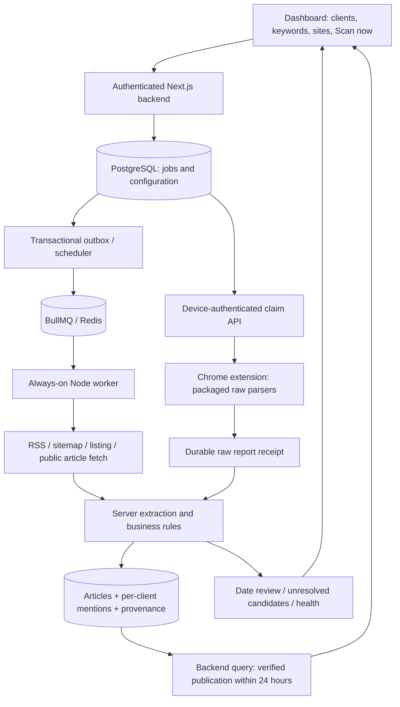

# Brand monitoring app: implementation plan

Prepared 11 October 2026 (Asia/Dhaka). Status: proposed, awaiting approval.

This document follows `SPEC.md` (the actual filename; the instructions call it `SPEC.MD`) and `AGENTS.md`. It contains design and proposed SQL only. No application, extension, migration, or infrastructure code has been implemented or executed. Approval of this plan authorizes starting slice 0 only; every subsequent slice requires a separate go-ahead.

## 1. Refined architecture and recommendations

### Operating assumptions

- V1 serves one internal reputation team. Approved users share its clients, watched sites, and public article corpus. Roles are admin, analyst, and viewer. Client selection scopes every mention query, export, and workflow action.
- This is not yet a multi-organization service. If clients require private accounts, or different team members must see different clients, decide that before slice 0; add tenant/ACL boundaries before creating the database.
- Use public news and publicly indexed social content. Logged-in search-engine browsing does not authorize collecting private social content or account data.
- Default display and source fallback timezone is `Asia/Dhaka`. Store instants as PostgreSQL `timestamptz`, configure database connections to UTC, and display local time. Site timezone overrides take precedence over the default when a source omits its offset.

### Components and responsibility boundaries

| Component | Responsibilities | Explicit boundary |
| --- | --- | --- |
| Next.js web app/backend | Authentication, approved-user access, client/keyword/site management, query generation, scheduling decisions, extension pairing/API, mention queries, review actions, health and exports | Public API and all business decisions live here or in its server-only domain package |
| Server-only domain package | Date parsing/confidence, Bangla normalization, title/body keyword matching, URL canonicalization, deduplication, 24-hour eligibility, clustering policy | Imported by backend and Node worker; never bundled into extension or browser UI |
| Always-on Node worker | RSS/Atom, sitemap and listing collection; anonymous HTTP fetch; extraction; invoking domain rules; persistence; retries and scheduling/outbox dispatch | A separate long-running process; request handlers do not run lengthy scans |
| PostgreSQL | Durable configuration, article/mention state, raw observations, job attempts/leases, receipt idempotency, outbox, health and audit history | Queue and lease authority; Redis is not the only copy of work |
| BullMQ + Redis | Worker wakeups, bounded concurrent execution, distributed per-domain throttling and retry delivery | Delivery is at least once; database writes must tolerate replay |
| Manifest V3 Chrome extension | Claim backend jobs, open owned background tabs, apply supported engine search options, parse structural results, capture bounded public article markup, report raw data, display operational state | No date interpretation, keyword evaluation, canonicalization, mention classification, deduplication, or 24-hour eligibility |

Keep Next.js, TypeScript, Tailwind, shadcn/ui, PostgreSQL with `pg_trgm`, BullMQ/Redis, an always-on Node worker, and a TypeScript MV3 extension as specified. Proposed repository boundaries after approval: `apps/web`, `apps/worker`, `apps/extension`, `packages/domain` (server only), `packages/contracts` (versioned data schemas only), `db/migrations`, `tests/fixtures`, and `docs`. Pin supported dependency versions during slice 0; do not install dependencies during this planning step.

Use a maintained OIDC authentication/session library with a selected organization identity provider. An external identity maps to an approved `app_users` record. Session cookies are Secure, HttpOnly, SameSite and backed by hashed, revocable application session tokens; browser dashboard mutations have CSRF protection. Do not implement passwords or custom OIDC/cryptography. Provider choice is an open question. No provider access/refresh token is needed for scanning and none is persisted in this schema.

Use separate migration and restricted runtime database credentials. Database tables are never accessible directly from the browser or extension. Backend authorization checks user activation and role on every request; analyst can manage clients/keywords/sites and review, viewer reads, admin additionally manages users/devices/settings and deployment-sensitive configuration. A device inherits its active owner's permissions and is accepted only when its owner can scan. This initial shared-team schema uses server authorization and foreign-key integrity rather than pretending it supplies tenant isolation.

### Collection and processing flow



1. Import approximately 100 watched sites using CSV or XLSX. Validate and preview before saving; CSV comes first in slice 2, with XLSX import in the same slice if the real input needs it. Preserve configured section URLs and site timezones.
2. Auto-detect in the specified order: RSS/Atom, XML/news sitemap, configured listing pages, site search as last resort. Preview includes discovered posts, method, raw date evidence, and diagnostics. A JS-dependent or protected site is marked extension-required. Support multiple feed/sitemap/listing endpoints per site rather than one overloaded URL field.
3. A database-backed scheduler creates one job per site/time bucket, or per search template and keyword revision/time bucket. Stable deduplication keys prevent duplicate schedules and repeated Scan now requests. Scheduler and dispatcher may run in the worker deployment.
4. Server connectors discover raw candidate URLs and evidence. Extension connectors provide the same information through a raw report adapter. A backend `SourceConnector` boundary yields candidates with `title`, `url`, `snippet`, nullable backend-parsed `published_at`, raw date evidence, observation time, engine/source, page, and position. The extension never fills a parsed `published_at`.
5. Resolve safe redirects, canonical URL claims and aliases; reserve/upsert article identity transactionally. Fetch/extract a known article once, then match the resulting normalized title and body against every active keyword across all clients. Reprocess stored content for keyword edits without fetching once per client.
6. Save both earliest `discovered_at` and article publication evidence. Relative strings are anchored to the source observation time, never to delayed processing time. Later indexed articles still qualify when their publication time is recent.
7. Keep one article and one workflow mention per client/article. Separate keyword match rows explain all matched terms/aliases and locations. Separate observations preserve site, Google, Bing, etc.; derive `found_by[]` from those observations rather than updating a fragile array on each mention.
8. Feed reads apply the publication rule at request time. Extraction, matching and receipt acceptance are distinct from collection status; accepting a report does not declare successful processing or zero mentions.

### The publication rule and Date unverified workflow

The main feed requires an extracted, readable article with complete title/body content, a current active keyword match for the selected active client, and verified publication evidence. `published_at` must lie between server statement time minus 24 hours and server statement time. Exactly 24 hours old is included; one microsecond older is excluded. Future-dated articles are excluded. Discovery time and sitemap `lastmod` never substitute for publication time. Incomplete bodies stay unresolved by default because truncation can hide an exclusion or Boolean NOT term as well as a positive match.

Store a candidate UTC instant, earliest/latest plausible publication bounds, confidence, precision, parser version, raw text, source and timezone assumption. Exact timestamps have equal lower/upper bounds. A coarse relative string or date-only value is admitted only if its entire plausible interval fits the window; otherwise it stays in Date unverified. This conservative boundary rule prevents an uncertain older article leaking into the main feed. A confidence number alone cannot verify a date.

Prefer credible publisher `datePublished` metadata (JSON-LD/OpenGraph), then explicit `<time>` publication fields, trustworthy RSS/news-sitemap publication fields, then source-specific visible dates. Never treat `dateModified` or generic sitemap `lastmod` as publication. Conflicting credible dates, missing timezones without a configured source assumption, implausible future values, or unknown relative-time semantics trigger review. Preserve all candidates and why a particular value was chosen. Rechecking future/scheduled publications is a bounded job; their age eligibility is still evaluated dynamically.

Actual title/body matches with unresolved dates get a mention whose article remains unverified; Date unverified shows it separately. Anonymous originals that cannot be extracted stay as unresolved raw candidates in scan history, with their query/client context and reason. A search snippet alone does not become a confirmed title/body mention. Manual date approval requires a reviewer, reason, raw evidence and publication bounds; it never substitutes discovery time. An approved older date moves into history, not the main feed.

All New/All/Flagged feeds and counters use this rule; Date unverified is a separate query. Quick windows are exactly 6, 12 and 24 hours. Explicit `show_older=true` uses a separate, authorized history query and still requires verified dates; unverified records remain separate. Ignored mentions are hidden by default but can be inspected with an explicit status filter within the same time boundary. CSV exports use the current client/filters/window and label whether older history was explicitly selected.

Do not store an `is_recent` flag or use a `now()` predicate in a partial index. Each response includes `server_time` and an expiry per article; the UI uses a server-aligned clock to remove expired cards, including after sleep/resume, and refreshes on focus. Live feed/counters use uncached database reads; query each pagination request against its current 24-hour lower bound. An export uses one bounded transaction timestamp. A syndicated story's representative and `also on N sites` are computed only from that client's matching articles eligible for the current view, so an older cluster member cannot surface through grouping.

### Bangla matching, canonicalization and deduplication

- Normalize NFC, remove the documented zero-width characters, and apply a tested, versioned equivalence map for relevant Bangla forms; do not strip meaningful Bangla vowel marks or punctuation indiscriminately. Normalize both keywords and extracted text. Detect suspected Bijoy/legacy encoding and report `encoding_problem`; do not claim zero mentions from unreadable text.
- Proposed semantics: `exact` matches any term/alias as a literal Unicode word/phrase with language-aware boundaries; `any` matches any literal term/alias without the whole-phrase boundary restriction; `boolean` evaluates a validated finite AND/OR/NOT expression tree over literal leaves. Aliases are alternatives; literal exclusions in title/body veto the rule. Never evaluate user expressions as JavaScript/SQL or allow unrestricted regex. Confirm these semantics in the questions below.
- Keep raw and normalized text and preserve match offsets for highlighting original text. Record rule revision and normalizer/matcher versions. Keyword edits create a new revision and a rematch job; obsolete matches are excluded until current revision evidence is ready. Preserve review status through rematching.
- Canonicalization removes fragments and known tracking parameters (`utm_*`, `fbclid`, `gclid`), normalizes host/default ports and permitted path variants, and resolves redirects, AMP/mobile variants and trusted `rel=canonical`. Preserve query parameters that identify content. Do not universally force HTTPS, lowercase paths, strip arbitrary query parameters, or rewrite trailing slashes on a site where they change the resource. Site-tested rules govern these transformations.
- A canonical URL has one article. Register its canonical form and every normalized alias in a URL identity map. Serialize concurrent canonical resolution, reread on conflict, and merge article aliases, observations and per-client matches/workflow deterministically if two provisional identities converge. Publication evidence is reconciled; contradictory verified timestamps return to review. Never deduplicate merely by title.
- Later near-duplicate clustering uses normalized content SHA-256 plus `pg_trgm` title similarity and a publication/context check. Keep each publisher article, date, URL and provenance; clustering groups presentation rather than deleting syndicated articles.

### Reliability, health and operations

PostgreSQL holds jobs, attempt generation, raw result receipts and a transactional outbox. A committed job/result and its corresponding outbox event are written in the same transaction. A dispatcher delivers events to BullMQ, with event/job UUID-based deduplication, and reconciles overdue database work after Redis loss. Worker processors check database state before effects and after replay. BullMQ's guidance also requires idempotent processors for retry-safe behavior. [BullMQ idempotent jobs](https://docs.bullmq.io/patterns/idempotent-jobs).

Claims use row locks and `FOR UPDATE SKIP LOCKED`, with consistent lock order and a fresh attempt UUID. PostgreSQL explicitly identifies `SKIP LOCKED` as suitable for queue-like access rather than general-purpose consistent reads. [PostgreSQL SELECT locking](https://www.postgresql.org/docs/current/sql-select.html).

Lock an engine policy row before claiming search work; then check all live leases and count engine attempts in the preceding rolling hour. This serializes that engine across all team devices and enforces the hourly cap atomically. Engine block cooldowns are global to the team. Site/article HTTP requests use a distributed per-host limiter and exponential backoff with jitter; honor server `Retry-After`. If Redis throttling is unavailable, pause acquisition and show degraded status rather than fetching without limits. Preview requests use the same worker/limiter.

Proposed conservative defaults, configurable after approval: site scan every 15 minutes; one active job/device; one active search/team/engine; 5-minute extension lease; 3 attempts; 2 search pages/job (social 1); 80 listing links/job; 10 search jobs/engine/rolling hour; 30-minute engine block cooldown; 15–45-second inter-job delay; 45-second page load timeout; 1 MiB report; one capture up to 512 KiB sanitized markup/report. These are starting limits, not coverage or anti-block guarantees. Split bulky site scans/captures into more jobs.

After a lease expires, mark its attempt expired and requeue with backoff. Stale reports cannot finish a replacement attempt. Genuine engine no-results, blocking, parser mismatch, unreadable content and extraction errors have separate statuses. Detect repeated zero links, anomalous drops from a productive parser, engine cooldown, missing heartbeats, processing backlog and encoding failures; maintain deduplicated, resolvable health events. Counters distinguish discovered URLs, extracted articles, matched client mentions and incomplete coverage.

Use structured logs with job/run/receipt/article IDs, latency and reason codes. Redact tokens, pairing codes, auth headers, account data and source content. Configure credentials through ignored `.env` files or deployment secrets; commit only a placeholder `.env.example` in slice 0. Use PostgreSQL backups and retention-controlled raw captures; keep synthetic/anonymized or legally usable public HTML fixtures. Proposed retention: raw reports 30 days, extracted public articles/mentions 12 months, audit/run summaries 12 months, subject to your answer. Raw expiry removes capture payload bytes only after processing has finished (or a failed item is explicitly closed), records `raw_expired_at`, and retains receipt IDs/digests/outcomes plus article/source provenance for longer history. Outbox payloads carry record IDs rather than duplicate raw captures. Do not delete a receipt while retained observations still reference it.

Deploy Next.js and the Node worker separately with PostgreSQL and Redis, TLS and a reverse proxy. Do not rely on a serverless request lifetime for always-on scanning. Deployment configuration must account for proxy limits and uncached authenticated feeds. [Next.js self-hosting guidance](https://nextjs.org/docs/app/guides/self-hosting).

Keep server fetches limited to HTTP(S) public destinations. Reject URL credentials, private/loopback/link-local addresses, internal DNS targets and unsafe redirects, and recheck each hop/resolution. Bound response size/time, XML entity expansion and crawl depth. The extension follows only origins authorized by job and host grants. Public server fetching uses no user cookies. Playwright remains an explicitly configured, public-page server fallback after ordinary extraction fails; it is not required for initial RSS/sitemap slices and does not replace the logged-in extension.

### Recommended specification refinements, with reasons

| Recommendation | Reason / effect |
| --- | --- |
| One mention per client/article, with separate keyword match rows | Prevent duplicate feed cards and conflicting review states when several aliases/keywords match |
| Normalize provenance as observations and derive `found_by[]` | Preserve every raw discovery, replay safely, and show cross-source collection history |
| Add endpoint records, date evidence/reviews, durable receipts, outbox and health records | Make scanning, ambiguous dates, failures and recovery auditable rather than silent |
| Add `site_search` as an explicit watched-site method | The collection requirements name this last-resort method although the draft method enum omits it |
| Add raw-only `article_capture` extension jobs | A JS article cannot be extracted by the backend from listing links alone |
| Prefer POST `/api/extension/jobs/claim` to mutating GET `/jobs/next` | Claiming modifies state; POST makes retry/idempotency/cache semantics clearer. Document the specified GET fallback if you prefer compatibility |
| Omit broad `tabs` permission; retain alarms/storage/scripting and narrow host grants | Chrome tab creation/removal does not require broad permission to read other tabs' sensitive properties; this reduces capability |
| Replace guaranteed immediate Scan now pickup with typical 30–60 seconds while awake, plus popup Poll now | MV3 alarms may be delayed and have a 30-second minimum; an immediate guarantee needs a separately designed push mechanism |
| Public social SERPs only in v1; anonymous original fetch where possible | Avoid private logged-in social content; inaccessible originals remain unresolved rather than overstating coverage |
| Shared-team v1 rather than premature multi-tenant scope | Fits an internal team and preserves global canonical URL uniqueness; confirm access requirements before migrations |

The source's known risks remain: scraping is fragile and search-engine terms may restrict it, indexed social coverage is partial, Chrome must be open, MV3 workers suspend, engine layouts change, and short names create false positives. Isolate engines, use health reporting, exact phrases/exclusions and conservative caps. Logged-in Chrome is an execution context, not a guarantee of access or completeness.

## 2. Full proposed SQL schema

This is the complete proposed target data schema for slices 0–9, including constraints, foreign keys, indexes, update timestamps and read views. It is documentation, not an applied migration. After approval, turn it into ordered, versioned migrations during slice 0; later slices activate their own behavior only. Target PostgreSQL 18 with `pg_trgm`; database provisioning/role credentials are deployment concerns and contain no secrets here.

SQL enums/checks enforce shape and identity; the backend still validates business transitions, timezone names, Boolean ASTs, query placeholders, capability declarations, rate reservations and timestamp credibility. The extension's `lease_id` is the fresh `scan_runs.id` UUID, used as a generation fence. Device bearer authentication provides the credential; no additional plaintext lease secret is required. All records use soft disable/revoke/resolve by default; destructive retention jobs use explicit deletion order and preserve audit summaries.

URL identity columns are limited to 2,048 bytes to keep direct PostgreSQL unique indexes practical; raw observed URLs can be longer. Oversized identity URLs are a visible validation/processing error, never silently truncated. Confirm this limit against real sites before finalizing the migration.

```sql
BEGIN;
SET LOCAL TIME ZONE 'UTC';
CREATE EXTENSION IF NOT EXISTS pg_trgm;
CREATE SCHEMA monitor;
SET LOCAL search_path = monitor, public;

CREATE DOMAIN http_url AS text
    CHECK (VALUE ~ '^https?://' AND octet_length(VALUE) <= 2048);
CREATE DOMAIN sha256 AS bytea CHECK (octet_length(VALUE) = 32);

CREATE TYPE user_role AS ENUM ('admin', 'analyst', 'viewer');
CREATE TYPE user_state AS ENUM ('invited', 'active', 'disabled');
CREATE TYPE match_mode AS ENUM ('exact', 'any', 'boolean');
CREATE TYPE site_method AS ENUM
    ('pending', 'rss', 'sitemap', 'listing', 'site_search', 'extension');
CREATE TYPE endpoint_kind AS ENUM
    ('feed', 'sitemap', 'news_sitemap', 'listing', 'site_search');
CREATE TYPE search_engine AS ENUM ('bing', 'duckduckgo', 'brave', 'google');
CREATE TYPE executor_kind AS ENUM ('server', 'extension');
CREATE TYPE job_kind AS ENUM
    ('site_scan', 'search', 'social_search', 'article_fetch',
     'article_capture', 'rematch', 'cluster', 'notify');
CREATE TYPE job_state AS ENUM ('queued', 'leased', 'done', 'failed', 'cancelled');
CREATE TYPE run_state AS ENUM
    ('running', 'ok', 'empty', 'blocked', 'error', 'expired', 'cancelled');
CREATE TYPE collection_outcome AS ENUM ('ok', 'empty', 'blocked', 'error');
CREATE TYPE extraction_state AS ENUM
    ('pending', 'succeeded', 'failed', 'blocked', 'encoding_problem', 'unavailable');
CREATE TYPE date_state AS ENUM ('unverified', 'verified', 'rejected');
CREATE TYPE mention_state AS ENUM ('new', 'reviewed', 'flagged', 'ignored');

CREATE TABLE app_users (
    id uuid PRIMARY KEY DEFAULT gen_random_uuid(),
    oidc_issuer text NOT NULL,
    oidc_subject text NOT NULL,
    email text,
    display_name text NOT NULL CHECK (btrim(display_name) <> ''),
    role user_role NOT NULL DEFAULT 'analyst',
    state user_state NOT NULL DEFAULT 'invited',
    preferred_timezone text,
    approved_by uuid REFERENCES app_users(id),
    approved_at timestamptz,
    created_at timestamptz NOT NULL DEFAULT now(),
    updated_at timestamptz NOT NULL DEFAULT now(),
    UNIQUE (oidc_issuer, oidc_subject),
    CHECK (state <> 'active' OR approved_at IS NOT NULL)
);

CREATE TABLE auth_sessions (
    id uuid PRIMARY KEY DEFAULT gen_random_uuid(),
    user_id uuid NOT NULL REFERENCES app_users(id),
    token_hash sha256 NOT NULL UNIQUE,
    created_at timestamptz NOT NULL DEFAULT now(),
    expires_at timestamptz NOT NULL,
    last_seen_at timestamptz,
    revoked_at timestamptz,
    CHECK (expires_at > created_at)
);
CREATE INDEX auth_sessions_user_idx ON auth_sessions(user_id, expires_at);

CREATE TABLE app_settings (
    id smallint PRIMARY KEY DEFAULT 1 CHECK (id = 1),
    display_timezone text NOT NULL DEFAULT 'Asia/Dhaka',
    extension_poll_seconds integer NOT NULL DEFAULT 30
        CHECK (extension_poll_seconds BETWEEN 30 AND 3600),
    extension_lease_seconds integer NOT NULL DEFAULT 300
        CHECK (extension_lease_seconds BETWEEN 60 AND 900),
    extension_offline_seconds integer NOT NULL DEFAULT 7200
        CHECK (extension_offline_seconds >= 120),
    delay_min_seconds integer NOT NULL DEFAULT 15 CHECK (delay_min_seconds >= 0),
    delay_max_seconds integer NOT NULL DEFAULT 45,
    raw_retention_days integer NOT NULL DEFAULT 30 CHECK (raw_retention_days > 0),
    article_retention_days integer NOT NULL DEFAULT 365 CHECK (article_retention_days > 0),
    operational_retention_days integer NOT NULL DEFAULT 365
        CHECK (operational_retention_days > 0),
    updated_by uuid REFERENCES app_users(id),
    updated_at timestamptz NOT NULL DEFAULT now(),
    CHECK (delay_max_seconds >= delay_min_seconds)
);
INSERT INTO app_settings (id) VALUES (1);

CREATE TABLE clients (
    id uuid PRIMARY KEY DEFAULT gen_random_uuid(),
    name text NOT NULL CHECK (btrim(name) <> ''),
    notes text,
    active boolean NOT NULL DEFAULT true,
    created_by uuid NOT NULL REFERENCES app_users(id),
    created_at timestamptz NOT NULL DEFAULT now(),
    updated_at timestamptz NOT NULL DEFAULT now()
);
CREATE INDEX clients_active_name_idx ON clients(active, name);

CREATE TABLE keywords (
    id uuid PRIMARY KEY DEFAULT gen_random_uuid(),
    client_id uuid NOT NULL REFERENCES clients(id),
    term text NOT NULL CHECK (btrim(term) <> ''),
    aliases text[] NOT NULL DEFAULT '{}',
    exclusions text[] NOT NULL DEFAULT '{}',
    match_type match_mode NOT NULL DEFAULT 'exact',
    boolean_ast jsonb,
    revision integer NOT NULL DEFAULT 1 CHECK (revision > 0),
    active boolean NOT NULL DEFAULT true,
    created_by uuid NOT NULL REFERENCES app_users(id),
    created_at timestamptz NOT NULL DEFAULT now(),
    updated_at timestamptz NOT NULL DEFAULT now(),
    UNIQUE (id, client_id),
    CHECK (array_position(aliases, NULL) IS NULL),
    CHECK (array_position(exclusions, NULL) IS NULL),
    CHECK ((match_type = 'boolean' AND boolean_ast IS NOT NULL
            AND jsonb_typeof(boolean_ast) = 'object')
        OR (match_type <> 'boolean' AND boolean_ast IS NULL))
);
CREATE INDEX keywords_client_active_idx ON keywords(client_id, active);

CREATE TABLE watched_sites (
    id uuid PRIMARY KEY DEFAULT gen_random_uuid(),
    name text NOT NULL CHECK (btrim(name) <> ''),
    site_url http_url NOT NULL UNIQUE,
    host text NOT NULL CHECK (btrim(host) <> ''),
    method site_method NOT NULL DEFAULT 'pending',
    source_timezone text NOT NULL DEFAULT 'Asia/Dhaka',
    language text NOT NULL DEFAULT 'bn',
    scan_depth integer NOT NULL DEFAULT 1 CHECK (scan_depth BETWEEN 0 AND 5),
    frequency_seconds integer NOT NULL DEFAULT 900 CHECK (frequency_seconds >= 60),
    active boolean NOT NULL DEFAULT true,
    encoding_status text NOT NULL DEFAULT 'unknown'
        CHECK (encoding_status IN ('unknown', 'unicode', 'suspected_legacy')),
    next_scan_at timestamptz,
    last_scanned_at timestamptz,
    last_new_posts integer CHECK (last_new_posts >= 0),
    consecutive_empty_runs integer NOT NULL DEFAULT 0 CHECK (consecutive_empty_runs >= 0),
    last_error_code text,
    last_error text,
    config jsonb NOT NULL DEFAULT '{}' CHECK (jsonb_typeof(config) = 'object'),
    created_by uuid NOT NULL REFERENCES app_users(id),
    created_at timestamptz NOT NULL DEFAULT now(),
    updated_at timestamptz NOT NULL DEFAULT now()
);
CREATE INDEX watched_sites_due_idx ON watched_sites(next_scan_at) WHERE active;

CREATE TABLE site_endpoints (
    id uuid PRIMARY KEY DEFAULT gen_random_uuid(),
    site_id uuid NOT NULL REFERENCES watched_sites(id),
    kind endpoint_kind NOT NULL,
    url http_url NOT NULL,
    active boolean NOT NULL DEFAULT true,
    is_primary boolean NOT NULL DEFAULT false,
    config jsonb NOT NULL DEFAULT '{}' CHECK (jsonb_typeof(config) = 'object'),
    discovered_at timestamptz NOT NULL DEFAULT now(),
    updated_at timestamptz NOT NULL DEFAULT now(),
    UNIQUE (site_id, url),
    UNIQUE (id, site_id)
);
CREATE UNIQUE INDEX site_endpoints_primary_idx
    ON site_endpoints(site_id) WHERE is_primary AND active;

CREATE TABLE search_templates (
    id uuid PRIMARY KEY DEFAULT gen_random_uuid(),
    name text NOT NULL CHECK (btrim(name) <> ''),
    engine search_engine NOT NULL,
    type job_kind NOT NULL CHECK (type IN ('search', 'social_search')),
    query_template text NOT NULL CHECK (btrim(query_template) <> ''),
    social_domain text,
    time_range text NOT NULL DEFAULT '24h' CHECK (time_range = '24h'),
    max_pages integer NOT NULL DEFAULT 2 CHECK (max_pages BETWEEN 1 AND 5),
    frequency_seconds integer NOT NULL DEFAULT 3600 CHECK (frequency_seconds >= 60),
    revision integer NOT NULL DEFAULT 1 CHECK (revision > 0),
    active boolean NOT NULL DEFAULT true,
    created_by uuid NOT NULL REFERENCES app_users(id),
    created_at timestamptz NOT NULL DEFAULT now(),
    updated_at timestamptz NOT NULL DEFAULT now(),
    CHECK ((type = 'social_search' AND social_domain IS NOT NULL)
        OR (type = 'search' AND social_domain IS NULL))
);

CREATE TABLE engine_policies (
    engine search_engine PRIMARY KEY,
    active boolean NOT NULL DEFAULT true,
    hourly_job_cap integer NOT NULL DEFAULT 10 CHECK (hourly_job_cap >= 0),
    cooldown_seconds integer NOT NULL DEFAULT 1800 CHECK (cooldown_seconds >= 30),
    cooldown_until timestamptz,
    last_block_reason text,
    updated_by uuid REFERENCES app_users(id),
    updated_at timestamptz NOT NULL DEFAULT now()
);
INSERT INTO engine_policies (engine)
VALUES ('bing'), ('duckduckgo'), ('brave'), ('google');

CREATE TABLE domain_policies (
    host text PRIMARY KEY CHECK (btrim(host) <> ''),
    active boolean NOT NULL DEFAULT true,
    min_delay_ms integer NOT NULL DEFAULT 2000 CHECK (min_delay_ms >= 0),
    max_concurrency integer NOT NULL DEFAULT 1 CHECK (max_concurrency BETWEEN 1 AND 5),
    cooldown_until timestamptz,
    updated_at timestamptz NOT NULL DEFAULT now()
);

CREATE TABLE extension_devices (
    id uuid PRIMARY KEY DEFAULT gen_random_uuid(),
    user_id uuid NOT NULL REFERENCES app_users(id),
    name text NOT NULL CHECK (btrim(name) <> ''),
    token_hash sha256 NOT NULL UNIQUE,
    token_expires_at timestamptz,
    token_rotated_at timestamptz NOT NULL DEFAULT now(),
    extension_version text NOT NULL,
    parser_versions jsonb NOT NULL DEFAULT '{}' CHECK (jsonb_typeof(parser_versions) = 'object'),
    supported_job_types text[] NOT NULL DEFAULT '{}',
    granted_origins text[] NOT NULL DEFAULT '{}',
    paused boolean NOT NULL DEFAULT false,
    last_seen_at timestamptz,
    last_successful_scan_at timestamptz,
    warnings jsonb NOT NULL DEFAULT '[]' CHECK (jsonb_typeof(warnings) = 'array'),
    revoked_at timestamptz,
    revoked_by uuid REFERENCES app_users(id),
    created_at timestamptz NOT NULL DEFAULT now(),
    updated_at timestamptz NOT NULL DEFAULT now()
);
CREATE INDEX extension_devices_user_idx ON extension_devices(user_id, last_seen_at DESC);

CREATE TABLE pairing_codes (
    id uuid PRIMARY KEY DEFAULT gen_random_uuid(),
    user_id uuid NOT NULL REFERENCES app_users(id),
    code_hash sha256 NOT NULL UNIQUE,
    created_at timestamptz NOT NULL DEFAULT now(),
    expires_at timestamptz NOT NULL,
    consumed_at timestamptz,
    consumed_by_device_id uuid REFERENCES extension_devices(id),
    CHECK (expires_at > created_at),
    CHECK ((consumed_at IS NULL AND consumed_by_device_id IS NULL)
        OR (consumed_at IS NOT NULL AND consumed_by_device_id IS NOT NULL))
);
CREATE INDEX pairing_codes_user_expiry_idx ON pairing_codes(user_id, expires_at);

CREATE TABLE article_clusters (
    id uuid PRIMARY KEY DEFAULT gen_random_uuid(),
    algorithm_version text NOT NULL,
    signature sha256,
    created_at timestamptz NOT NULL DEFAULT now(),
    updated_at timestamptz NOT NULL DEFAULT now()
);

CREATE TABLE articles (
    id uuid PRIMARY KEY DEFAULT gen_random_uuid(),
    canonical_url http_url NOT NULL UNIQUE,
    origin_host text NOT NULL,
    title text NOT NULL DEFAULT '',
    body_text text,
    normalized_title text,
    normalized_body_text text,
    content_complete boolean NOT NULL DEFAULT false,
    language text,
    extraction_status extraction_state NOT NULL DEFAULT 'pending',
    extraction_version text,
    normalizer_version text,
    extracted_at timestamptz,
    extraction_error_code text,
    published_at timestamptz,
    published_lower_bound timestamptz,
    published_upper_bound timestamptz,
    date_status date_state NOT NULL DEFAULT 'unverified',
    date_confidence numeric(4,3) CHECK (date_confidence BETWEEN 0 AND 1),
    date_reason_code text,
    selected_evidence_id uuid,
    discovered_at timestamptz NOT NULL DEFAULT now(),
    last_discovered_at timestamptz NOT NULL DEFAULT now(),
    content_hash sha256,
    cluster_id uuid REFERENCES article_clusters(id),
    created_at timestamptz NOT NULL DEFAULT now(),
    updated_at timestamptz NOT NULL DEFAULT now(),
    CHECK (last_discovered_at >= discovered_at),
    CHECK ((published_at IS NULL AND published_lower_bound IS NULL
            AND published_upper_bound IS NULL)
        OR (published_at IS NOT NULL AND published_lower_bound IS NOT NULL
            AND published_upper_bound IS NOT NULL
            AND published_lower_bound <= published_at
            AND published_at <= published_upper_bound)),
    CHECK (date_status <> 'verified'
        OR (published_at IS NOT NULL AND selected_evidence_id IS NOT NULL
            AND date_confidence IS NOT NULL)),
    CHECK (extraction_status <> 'succeeded'
        OR (extracted_at IS NOT NULL AND extraction_version IS NOT NULL
            AND normalizer_version IS NOT NULL AND btrim(title) <> ''
            AND content_complete AND body_text IS NOT NULL AND btrim(body_text) <> ''
            AND normalized_title IS NOT NULL AND normalized_body_text IS NOT NULL))
);
CREATE INDEX articles_published_idx ON articles(published_at DESC, id DESC)
    WHERE date_status = 'verified';
CREATE INDEX articles_unverified_idx ON articles(discovered_at DESC)
    WHERE date_status = 'unverified';
CREATE INDEX articles_hash_idx ON articles(content_hash) WHERE content_hash IS NOT NULL;
CREATE INDEX articles_title_trgm_idx ON articles USING gin(normalized_title gin_trgm_ops);
CREATE INDEX articles_cluster_idx ON articles(cluster_id) WHERE cluster_id IS NOT NULL;

CREATE TABLE article_url_aliases (
    url http_url PRIMARY KEY,
    article_id uuid NOT NULL REFERENCES articles(id),
    kind text NOT NULL CHECK (kind IN ('canonical', 'redirect', 'amp', 'mobile', 'observed')),
    first_seen_at timestamptz NOT NULL DEFAULT now(),
    last_seen_at timestamptz NOT NULL DEFAULT now(),
    CHECK (last_seen_at >= first_seen_at)
);
CREATE INDEX article_url_aliases_article_idx ON article_url_aliases(article_id);

CREATE TABLE publication_evidence (
    id uuid PRIMARY KEY DEFAULT gen_random_uuid(),
    article_id uuid NOT NULL REFERENCES articles(id),
    source_kind text NOT NULL CHECK (source_kind IN
        ('jsonld', 'opengraph', 'time', 'rss', 'news_sitemap',
         'visible_text', 'extension_display', 'manual')),
    raw_value text NOT NULL,
    source_url http_url,
    field_path text,
    observed_at timestamptz NOT NULL,
    server_received_at timestamptz NOT NULL DEFAULT now(),
    assumed_timezone text,
    parser_version text NOT NULL,
    parsed_at timestamptz,
    lower_bound timestamptz,
    upper_bound timestamptz,
    precision text CHECK (precision IN ('second', 'minute', 'hour', 'day', 'unknown')),
    confidence numeric(4,3) CHECK (confidence BETWEEN 0 AND 1),
    rejection_reason text,
    created_at timestamptz NOT NULL DEFAULT now(),
    UNIQUE (article_id, id),
    CHECK ((parsed_at IS NULL AND lower_bound IS NULL AND upper_bound IS NULL)
        OR (parsed_at IS NOT NULL AND lower_bound IS NOT NULL AND upper_bound IS NOT NULL
            AND lower_bound <= parsed_at AND parsed_at <= upper_bound))
);
ALTER TABLE articles ADD CONSTRAINT articles_selected_evidence_fk
    FOREIGN KEY (id, selected_evidence_id)
    REFERENCES publication_evidence(article_id, id) DEFERRABLE INITIALLY DEFERRED;
CREATE INDEX publication_evidence_article_idx ON publication_evidence(article_id, observed_at);

CREATE TABLE date_reviews (
    id uuid PRIMARY KEY DEFAULT gen_random_uuid(),
    article_id uuid NOT NULL REFERENCES articles(id),
    evidence_id uuid,
    reviewer_id uuid NOT NULL REFERENCES app_users(id),
    decision text NOT NULL CHECK (decision IN ('verify', 'reject', 'return_to_unverified')),
    previous_date_status date_state NOT NULL,
    previous_published_at timestamptz,
    resolved_published_at timestamptz,
    resolved_lower_bound timestamptz,
    resolved_upper_bound timestamptz,
    reason text NOT NULL CHECK (btrim(reason) <> ''),
    created_at timestamptz NOT NULL DEFAULT now(),
    FOREIGN KEY (article_id, evidence_id) REFERENCES publication_evidence(article_id, id)
        DEFERRABLE INITIALLY DEFERRED,
    CHECK (decision <> 'verify'
        OR (evidence_id IS NOT NULL AND resolved_published_at IS NOT NULL
            AND resolved_lower_bound IS NOT NULL AND resolved_upper_bound IS NOT NULL
            AND resolved_lower_bound <= resolved_published_at
            AND resolved_published_at <= resolved_upper_bound))
);
CREATE INDEX date_reviews_article_idx ON date_reviews(article_id, created_at DESC);

CREATE TABLE mentions (
    id uuid PRIMARY KEY DEFAULT gen_random_uuid(),
    client_id uuid NOT NULL REFERENCES clients(id),
    article_id uuid NOT NULL REFERENCES articles(id),
    status mention_state NOT NULL DEFAULT 'new',
    status_changed_by uuid REFERENCES app_users(id),
    status_changed_at timestamptz,
    first_matched_at timestamptz NOT NULL DEFAULT now(),
    last_matched_at timestamptz NOT NULL DEFAULT now(),
    created_at timestamptz NOT NULL DEFAULT now(),
    updated_at timestamptz NOT NULL DEFAULT now(),
    UNIQUE (client_id, article_id),
    UNIQUE (id, client_id),
    CHECK (last_matched_at >= first_matched_at)
);
CREATE INDEX mentions_client_status_idx ON mentions(client_id, status, article_id);
CREATE INDEX mentions_article_idx ON mentions(article_id);

CREATE TABLE mention_matches (
    id uuid PRIMARY KEY DEFAULT gen_random_uuid(),
    client_id uuid NOT NULL REFERENCES clients(id),
    mention_id uuid NOT NULL,
    keyword_id uuid NOT NULL,
    keyword_revision integer NOT NULL CHECK (keyword_revision > 0),
    matched_aliases text[] NOT NULL DEFAULT '{}',
    matched_in text NOT NULL CHECK (matched_in IN ('title', 'body', 'both')),
    excerpts jsonb NOT NULL CHECK (jsonb_typeof(excerpts) = 'array'),
    matcher_version text NOT NULL,
    normalizer_version text NOT NULL,
    active boolean NOT NULL DEFAULT true,
    first_matched_at timestamptz NOT NULL DEFAULT now(),
    last_matched_at timestamptz NOT NULL DEFAULT now(),
    UNIQUE (mention_id, keyword_id, keyword_revision),
    FOREIGN KEY (mention_id, client_id) REFERENCES mentions(id, client_id),
    FOREIGN KEY (keyword_id, client_id) REFERENCES keywords(id, client_id),
    CHECK (last_matched_at >= first_matched_at)
);
CREATE INDEX mention_matches_keyword_idx ON mention_matches(keyword_id, keyword_revision);
CREATE INDEX mention_matches_current_idx ON mention_matches(mention_id) WHERE active;

CREATE TABLE scan_jobs (
    id uuid PRIMARY KEY DEFAULT gen_random_uuid(),
    executor executor_kind NOT NULL,
    type job_kind NOT NULL,
    site_id uuid REFERENCES watched_sites(id),
    client_id uuid REFERENCES clients(id),
    keyword_id uuid,
    template_id uuid REFERENCES search_templates(id),
    article_id uuid REFERENCES articles(id),
    engine search_engine,
    payload jsonb NOT NULL CHECK (jsonb_typeof(payload) = 'object'),
    schema_version integer NOT NULL DEFAULT 1 CHECK (schema_version > 0),
    deduplication_key text NOT NULL UNIQUE CHECK (octet_length(deduplication_key) <= 512),
    status job_state NOT NULL DEFAULT 'queued',
    priority integer NOT NULL DEFAULT 0,
    available_at timestamptz NOT NULL DEFAULT now(),
    attempts integer NOT NULL DEFAULT 0 CHECK (attempts >= 0),
    max_attempts integer NOT NULL DEFAULT 3 CHECK (max_attempts BETWEEN 1 AND 10),
    current_run_id uuid,
    leased_to_device_id uuid REFERENCES extension_devices(id),
    leased_to_worker_id text,
    lease_expires_at timestamptz,
    last_error_code text,
    last_error text,
    requested_by uuid REFERENCES app_users(id),
    created_at timestamptz NOT NULL DEFAULT now(),
    updated_at timestamptz NOT NULL DEFAULT now(),
    UNIQUE (id, executor),
    FOREIGN KEY (keyword_id, client_id) REFERENCES keywords(id, client_id),
    CHECK (keyword_id IS NULL OR client_id IS NOT NULL),
    CHECK (attempts <= max_attempts),
    CHECK ((type IN ('search', 'social_search') AND engine IS NOT NULL
            AND executor = 'extension')
        OR (type NOT IN ('search', 'social_search') AND engine IS NULL)),
    CHECK ((executor = 'extension' AND type IN
            ('site_scan', 'search', 'social_search', 'article_capture'))
        OR (executor = 'server' AND type IN
            ('site_scan', 'article_fetch', 'rematch', 'cluster', 'notify'))),
    CHECK (CASE WHEN status = 'leased' THEN
        current_run_id IS NOT NULL AND lease_expires_at IS NOT NULL AND
        ((executor = 'extension' AND leased_to_device_id IS NOT NULL
            AND leased_to_worker_id IS NULL)
         OR (executor = 'server' AND leased_to_worker_id IS NOT NULL
            AND leased_to_device_id IS NULL))
        ELSE current_run_id IS NULL AND lease_expires_at IS NULL
            AND leased_to_device_id IS NULL AND leased_to_worker_id IS NULL END)
);
CREATE INDEX scan_jobs_claim_idx
    ON scan_jobs(executor, available_at, priority DESC, created_at) WHERE status = 'queued';
CREATE INDEX scan_jobs_expiry_idx ON scan_jobs(lease_expires_at) WHERE status = 'leased';
CREATE INDEX scan_jobs_engine_live_idx ON scan_jobs(engine, lease_expires_at) WHERE status = 'leased';
CREATE INDEX scan_jobs_client_idx ON scan_jobs(client_id, created_at DESC);
CREATE INDEX scan_jobs_site_idx ON scan_jobs(site_id, created_at DESC);

CREATE TABLE scan_runs (
    id uuid PRIMARY KEY DEFAULT gen_random_uuid(),
    job_id uuid NOT NULL,
    executor executor_kind NOT NULL,
    attempt_no integer NOT NULL CHECK (attempt_no > 0),
    device_id uuid REFERENCES extension_devices(id),
    worker_id text,
    engine search_engine,
    site_id uuid REFERENCES watched_sites(id),
    status run_state NOT NULL DEFAULT 'running',
    started_at timestamptz NOT NULL DEFAULT now(),
    lease_expires_at timestamptz NOT NULL,
    finished_at timestamptz,
    parser_id text,
    parser_version text,
    extension_version text,
    discovered_count integer NOT NULL DEFAULT 0 CHECK (discovered_count >= 0),
    extracted_count integer NOT NULL DEFAULT 0 CHECK (extracted_count >= 0),
    matched_count integer NOT NULL DEFAULT 0 CHECK (matched_count >= 0),
    partial boolean NOT NULL DEFAULT false,
    reason_code text,
    diagnostics jsonb NOT NULL DEFAULT '{}' CHECK (jsonb_typeof(diagnostics) = 'object'),
    UNIQUE (job_id, attempt_no),
    UNIQUE (job_id, id),
    UNIQUE (id, device_id),
    FOREIGN KEY (job_id, executor) REFERENCES scan_jobs(id, executor),
    CHECK (lease_expires_at > started_at),
    CHECK ((executor = 'extension' AND device_id IS NOT NULL AND worker_id IS NULL)
        OR (executor = 'server' AND worker_id IS NOT NULL AND device_id IS NULL)),
    CHECK ((status = 'running' AND finished_at IS NULL)
        OR (status <> 'running' AND finished_at IS NOT NULL AND finished_at >= started_at)),
    CHECK (status <> 'empty' OR (discovered_count = 0 AND NOT partial))
);
ALTER TABLE scan_jobs ADD CONSTRAINT scan_jobs_current_run_fk
    FOREIGN KEY (id, current_run_id) REFERENCES scan_runs(job_id, id)
    DEFERRABLE INITIALLY DEFERRED;
CREATE INDEX scan_runs_engine_hour_idx ON scan_runs(engine, started_at DESC);
CREATE INDEX scan_runs_site_history_idx ON scan_runs(site_id, started_at DESC);
CREATE INDEX scan_runs_device_history_idx ON scan_runs(device_id, started_at DESC);
CREATE UNIQUE INDEX scan_runs_one_active_device_idx
    ON scan_runs(device_id) WHERE status = 'running' AND device_id IS NOT NULL;
CREATE UNIQUE INDEX scan_runs_one_active_engine_idx
    ON scan_runs(engine) WHERE status = 'running' AND engine IS NOT NULL;

CREATE TABLE extension_claims (
    device_id uuid NOT NULL REFERENCES extension_devices(id),
    request_id uuid NOT NULL,
    run_id uuid,
    http_status smallint NOT NULL CHECK (http_status IN (200, 204)),
    response_payload jsonb,
    created_at timestamptz NOT NULL DEFAULT now(),
    expires_at timestamptz NOT NULL,
    PRIMARY KEY (device_id, request_id),
    FOREIGN KEY (run_id, device_id) REFERENCES scan_runs(id, device_id),
    CHECK (expires_at > created_at),
    CHECK ((http_status = 200 AND run_id IS NOT NULL AND response_payload IS NOT NULL
            AND jsonb_typeof(response_payload) = 'object')
        OR (http_status = 204 AND run_id IS NULL AND response_payload IS NULL))
);

CREATE TABLE result_receipts (
    id uuid PRIMARY KEY DEFAULT gen_random_uuid(),
    run_id uuid NOT NULL UNIQUE REFERENCES scan_runs(id),
    report_id uuid NOT NULL UNIQUE,
    payload_hash sha256 NOT NULL,
    schema_version integer NOT NULL CHECK (schema_version > 0),
    outcome collection_outcome NOT NULL,
    raw_payload jsonb NOT NULL CHECK (jsonb_typeof(raw_payload) = 'object'),
    raw_expired_at timestamptz,
    accepted_at timestamptz NOT NULL DEFAULT now(),
    processing_state text NOT NULL DEFAULT 'pending'
        CHECK (processing_state IN ('pending', 'processing', 'processed', 'failed')),
    processing_attempts integer NOT NULL DEFAULT 0 CHECK (processing_attempts >= 0),
    next_processing_at timestamptz NOT NULL DEFAULT now(),
    processing_claim_id uuid,
    processing_started_at timestamptz,
    processing_lease_expires_at timestamptz,
    processed_at timestamptz,
    processing_error_code text,
    processing_error text,
    UNIQUE (id, run_id),
    CHECK ((processing_state = 'processed' AND processed_at IS NOT NULL)
        OR (processing_state <> 'processed' AND processed_at IS NULL)),
    CHECK ((processing_state = 'processing' AND processing_claim_id IS NOT NULL
            AND processing_started_at IS NOT NULL AND processing_lease_expires_at IS NOT NULL
            AND processing_lease_expires_at > processing_started_at)
        OR (processing_state <> 'processing' AND processing_claim_id IS NULL
            AND processing_started_at IS NULL AND processing_lease_expires_at IS NULL)),
    CHECK (raw_expired_at IS NULL
        OR (processing_state IN ('processed', 'failed') AND raw_payload = '{}'::jsonb))
);
CREATE INDEX result_receipts_processing_idx ON result_receipts(next_processing_at, accepted_at)
    WHERE processing_state = 'pending';
CREATE INDEX result_receipts_expiry_idx ON result_receipts(processing_lease_expires_at)
    WHERE processing_state = 'processing';

CREATE TABLE discovery_observations (
    id uuid PRIMARY KEY DEFAULT gen_random_uuid(),
    receipt_id uuid NOT NULL,
    run_id uuid NOT NULL,
    ordinal integer NOT NULL CHECK (ordinal > 0),
    article_id uuid REFERENCES articles(id),
    site_id uuid REFERENCES watched_sites(id),
    source text NOT NULL CHECK (source IN
        ('rss', 'sitemap', 'listing', 'site_search', 'search', 'social_search', 'article_capture')),
    engine search_engine,
    raw_url text NOT NULL CHECK (octet_length(raw_url) <= 8192),
    raw_title text,
    raw_snippet text,
    raw_dates jsonb NOT NULL DEFAULT '[]' CHECK (jsonb_typeof(raw_dates) = 'array'),
    page integer CHECK (page > 0),
    position integer CHECK (position > 0),
    observed_at timestamptz NOT NULL,
    server_received_at timestamptz NOT NULL DEFAULT now(),
    resolution_state text NOT NULL DEFAULT 'pending'
        CHECK (resolution_state IN ('pending', 'resolved', 'unavailable', 'error')),
    resolution_reason text,
    UNIQUE (receipt_id, ordinal),
    FOREIGN KEY (receipt_id, run_id) REFERENCES result_receipts(id, run_id),
    CHECK (resolution_state <> 'resolved' OR article_id IS NOT NULL),
    CHECK ((source IN ('search', 'social_search') AND engine IS NOT NULL)
        OR (source NOT IN ('search', 'social_search') AND engine IS NULL))
);
CREATE INDEX discovery_observations_article_idx ON discovery_observations(article_id, observed_at);
CREATE INDEX discovery_observations_pending_idx ON discovery_observations(resolution_state, server_received_at);

CREATE TABLE outbox_events (
    id uuid PRIMARY KEY DEFAULT gen_random_uuid(),
    topic text NOT NULL CHECK (topic IN
        ('scan_ready', 'process_receipt', 'rematch', 'cluster', 'notify_health')),
    deduplication_key text NOT NULL UNIQUE CHECK (octet_length(deduplication_key) <= 512),
    payload jsonb NOT NULL CHECK (jsonb_typeof(payload) = 'object'),
    state text NOT NULL DEFAULT 'pending'
        CHECK (state IN ('pending', 'delivering', 'delivered', 'failed')),
    available_at timestamptz NOT NULL DEFAULT now(),
    attempts integer NOT NULL DEFAULT 0 CHECK (attempts >= 0),
    claim_id uuid,
    claim_expires_at timestamptz,
    delivered_at timestamptz,
    last_error text,
    created_at timestamptz NOT NULL DEFAULT now(),
    CHECK ((state = 'delivering' AND claim_id IS NOT NULL AND claim_expires_at IS NOT NULL)
        OR (state <> 'delivering' AND claim_id IS NULL AND claim_expires_at IS NULL)),
    CHECK (state <> 'delivered' OR delivered_at IS NOT NULL)
);
CREATE INDEX outbox_events_pending_idx ON outbox_events(available_at, created_at) WHERE state = 'pending';
CREATE INDEX outbox_events_expiry_idx ON outbox_events(claim_expires_at) WHERE state = 'delivering';

CREATE TABLE health_events (
    id uuid PRIMARY KEY DEFAULT gen_random_uuid(),
    deduplication_key text NOT NULL UNIQUE CHECK (octet_length(deduplication_key) <= 512),
    target_type text NOT NULL CHECK (target_type IN ('app', 'site', 'engine', 'device')),
    site_id uuid REFERENCES watched_sites(id),
    engine search_engine,
    device_id uuid REFERENCES extension_devices(id),
    code text NOT NULL,
    severity text NOT NULL CHECK (severity IN ('info', 'warning', 'error')),
    state text NOT NULL DEFAULT 'open' CHECK (state IN ('open', 'acknowledged', 'resolved')),
    message text NOT NULL,
    diagnostics jsonb NOT NULL DEFAULT '{}' CHECK (jsonb_typeof(diagnostics) = 'object'),
    occurrence_count integer NOT NULL DEFAULT 1 CHECK (occurrence_count > 0),
    first_seen_at timestamptz NOT NULL DEFAULT now(),
    last_seen_at timestamptz NOT NULL DEFAULT now(),
    acknowledged_by uuid REFERENCES app_users(id),
    resolved_at timestamptz,
    updated_at timestamptz NOT NULL DEFAULT now(),
    CHECK (last_seen_at >= first_seen_at),
    CHECK ((target_type = 'app' AND site_id IS NULL AND engine IS NULL AND device_id IS NULL)
        OR (target_type = 'site' AND site_id IS NOT NULL AND engine IS NULL AND device_id IS NULL)
        OR (target_type = 'engine' AND engine IS NOT NULL AND site_id IS NULL AND device_id IS NULL)
        OR (target_type = 'device' AND device_id IS NOT NULL AND site_id IS NULL AND engine IS NULL)),
    CHECK ((state = 'resolved' AND resolved_at IS NOT NULL)
        OR (state <> 'resolved' AND resolved_at IS NULL))
);
CREATE INDEX health_events_open_idx ON health_events(severity, last_seen_at DESC) WHERE state <> 'resolved';

CREATE TABLE notification_deliveries (
    id uuid PRIMARY KEY DEFAULT gen_random_uuid(),
    health_event_id uuid NOT NULL REFERENCES health_events(id),
    occurrence_no integer NOT NULL CHECK (occurrence_no > 0),
    channel text NOT NULL CHECK (channel IN ('email', 'telegram')),
    recipient_config_key text NOT NULL,
    status text NOT NULL DEFAULT 'pending' CHECK (status IN ('pending', 'sent', 'failed')),
    attempts integer NOT NULL DEFAULT 0 CHECK (attempts >= 0),
    sent_at timestamptz,
    provider_message_id text,
    last_error text,
    created_at timestamptz NOT NULL DEFAULT now(),
    UNIQUE (health_event_id, occurrence_no, channel, recipient_config_key),
    CHECK (status <> 'sent' OR sent_at IS NOT NULL)
);

CREATE TABLE audit_events (
    id bigint GENERATED ALWAYS AS IDENTITY PRIMARY KEY,
    actor_user_id uuid REFERENCES app_users(id),
    actor_device_id uuid REFERENCES extension_devices(id),
    action text NOT NULL,
    entity_type text NOT NULL,
    entity_id uuid,
    changes jsonb NOT NULL DEFAULT '{}' CHECK (jsonb_typeof(changes) = 'object'),
    created_at timestamptz NOT NULL DEFAULT now()
);
CREATE INDEX audit_events_entity_idx ON audit_events(entity_type, entity_id, created_at DESC);

-- Preserve separate source observations while exposing the SPEC found_by[] shape.
CREATE VIEW article_found_by AS
SELECT article_id,
       array_agg(DISTINCT CASE WHEN engine IS NOT NULL THEN engine::text
                              ELSE source END) AS found_by
FROM discovery_observations
WHERE article_id IS NOT NULL
GROUP BY article_id;

-- Deliberately dynamic: an article expires without a write or scheduler tick.
-- The API additionally applies selected client, status, keyword/source/site filters.
CREATE VIEW current_mentions_24h AS
SELECT m.id AS mention_id, m.client_id, m.article_id, m.status,
       a.canonical_url, a.title, a.origin_host, a.published_at,
       a.published_lower_bound, a.published_upper_bound,
       a.discovered_at, a.language, a.cluster_id
FROM mentions m
JOIN clients c ON c.id = m.client_id
JOIN articles a ON a.id = m.article_id
WHERE c.active
  AND a.extraction_status = 'succeeded'
  AND a.content_complete
  AND a.date_status = 'verified'
  AND a.published_at >= statement_timestamp() - interval '24 hours'
  AND a.published_at <= statement_timestamp()
  AND a.published_lower_bound >= statement_timestamp() - interval '24 hours'
  AND a.published_upper_bound <= statement_timestamp()
  AND EXISTS (
      SELECT 1 FROM mention_matches mm
      JOIN keywords k ON k.id = mm.keyword_id AND k.client_id = mm.client_id
      WHERE mm.mention_id = m.id AND mm.client_id = m.client_id
        AND mm.active AND k.active AND mm.keyword_revision = k.revision
  );

CREATE VIEW date_unverified_mentions AS
SELECT m.id AS mention_id, m.client_id, m.article_id, m.status,
       a.canonical_url, a.title, a.discovered_at, a.date_reason_code,
       a.published_at, a.published_lower_bound, a.published_upper_bound
FROM mentions m
JOIN clients c ON c.id = m.client_id
JOIN articles a ON a.id = m.article_id
WHERE c.active AND a.extraction_status = 'succeeded'
  AND (a.date_status = 'unverified'
       OR (a.date_status = 'verified' AND
           (a.published_upper_bound > statement_timestamp()
            OR (a.published_lower_bound < statement_timestamp() - interval '24 hours'
                AND a.published_upper_bound >= statement_timestamp() - interval '24 hours'))))
  AND EXISTS (
      SELECT 1 FROM mention_matches mm
      JOIN keywords k ON k.id = mm.keyword_id AND k.client_id = mm.client_id
      WHERE mm.mention_id = m.id AND mm.client_id = m.client_id
        AND mm.active AND k.active AND mm.keyword_revision = k.revision
  );

CREATE FUNCTION touch_updated_at() RETURNS trigger
LANGUAGE plpgsql AS $body$
BEGIN
    NEW.updated_at := statement_timestamp();
    RETURN NEW;
END;
$body$;

DO $body$
DECLARE table_name text;
BEGIN
    FOREACH table_name IN ARRAY ARRAY[
        'app_users', 'app_settings', 'clients', 'keywords', 'watched_sites',
        'site_endpoints', 'search_templates', 'engine_policies', 'domain_policies',
        'extension_devices', 'article_clusters', 'articles', 'mentions',
        'scan_jobs', 'health_events'
    ] LOOP
        EXECUTE format(
            'CREATE TRIGGER touch_updated_at BEFORE UPDATE ON monitor.%I '
            'FOR EACH ROW EXECUTE FUNCTION monitor.touch_updated_at()', table_name);
    END LOOP;
END;
$body$;

-- Provision restricted runtime roles separately. No PUBLIC table/function access.
REVOKE ALL ON SCHEMA monitor FROM PUBLIC;
REVOKE ALL ON ALL TABLES IN SCHEMA monitor FROM PUBLIC;
REVOKE ALL ON ALL SEQUENCES IN SCHEMA monitor FROM PUBLIC;
REVOKE ALL ON ALL FUNCTIONS IN SCHEMA monitor FROM PUBLIC;
COMMIT;
```

### Transaction rules that accompany the schema

- Bootstrap one approved administrator against the chosen OIDC issuer/subject through a controlled deployment procedure; do not make first anonymous login an administrator. Role provisioning grants only required tables/views/functions to backend/worker/auth roles and uses separate migration credentials. There are no database credentials or secrets in this document.
- Atomically insert a job and outbox event. Redis delivery does not mark a job done. Stable keys include target, configuration/rule revision and schedule bucket; manual scan keys include a user-request UUID.
- For an extension claim: authorize device/owner, replay an existing `(device_id, request_id)` if still valid, lock engine policy if applicable, lock the device capacity row, check global live lease/cap/cooldown, retire expired running attempts, lock eligible job, create `scan_runs`, increment attempts, set current run/owner/expiry, insert claim receipt, commit. An idle `204` is also replayable for that request ID; use a fresh ID for the next poll. A replay whose run expired returns a conflict and never claims a second job. Consistent engine/device/job lock ordering prevents races/deadlocks; partial unique indexes additionally prohibit two running attempts for one device or engine.
- For completion: check active device and report UUID/digest first. An exact already-accepted replay returns its receipt. Otherwise lock job/run, require matching current run, owner and unexpired lease, insert raw receipt and outbox event, finish collection run, clear lease fields and mark job done (or requeue blocked/retryable error with policy backoff). The attempt and receipt retain the observed outcome. Later processing updates separate extraction/matching counts and receipt state. Collection errors with raw partial rows can still have their receipt processed.
- Receipt processing separately claims a pending row with a fresh `processing_claim_id`, start/expiry and attempt counter. Completion and its resulting article/match writes require a matching unexpired claim under a row lock in the same commit; a stale processor cannot overwrite newer results. Expired processing claims reset to pending with backoff and a new outbox wakeup; the database reconciler recovers abandoned processing even after Redis loss. Large reports are bounded so final database commits stay short; HTTP work happens outside the lock and must be abandoned if the fence is lost.
- Canonical article creation and canonical alias registration are one transaction; lock conflicting identities in a consistent order. A merge transaction moves observations, evidence, aliases and matches, resolves one mention/client and retains review audit. Do not rely on two unrelated unique indexes alone to guarantee identity across canonical and alias tables.
- When approving a date, insert manual evidence and `date_reviews` plus audit and update article selection/bounds/status in the same transaction. Application validation enforces equality to selected evidence and source credibility; the deferred FK guarantees selected evidence belongs to that article.
- Match upserts are keyed by mention/keyword/revision and keep one workflow row per client/article. Revision changes and activation/exclusion changes enqueue rematching. No obsolete keyword revision qualifies a main-feed result.
- Backend APIs enforce selected-client scope even for bulk IDs and exports. Deny action on IDs belonging to another selected client. SQL composite FKs prevent cross-client keyword evidence even if a caller mistakes an ID.
- Health keys identify recurring conditions; reopen/update an existing condition when it recurs. Notifications use an occurrence number and deduplication key, with recipients configured outside source control. Scheduled external notifications are implemented only in slice 9 after recipients/channels are selected.

## 3. Chrome extension design

### Manifest and permissions

The following is a design example, not an extension file. Replace `APP_HOST` with the exact deployment host at build time. Use a separate development manifest for the explicit local backend origin. Chrome 120 is the proposed minimum for 30-second alarm support.

```json
{
  "manifest_version": 3,
  "name": "Brand Monitor Worker",
  "version": "0.1.0",
  "minimum_chrome_version": "120",
  "background": { "service_worker": "service-worker.js", "type": "module" },
  "action": { "default_popup": "popup.html" },
  "permissions": ["alarms", "storage", "scripting"],
  "host_permissions": [
    "https://APP_HOST/*",
    "https://www.bing.com/*",
    "https://duckduckgo.com/*",
    "https://search.brave.com/*",
    "https://www.google.com/*"
  ],
  "optional_host_permissions": ["https://*/*"],
  "content_security_policy": {
    "extension_pages": "script-src 'self'; object-src 'none'"
  }
}
```

| Permission | Purpose |
| --- | --- |
| `alarms` | Polling, deadline recovery and cooldown wakeups that survive service-worker suspension |
| `storage` | Device token and a small persistent state journal in trusted local extension storage |
| `scripting` | Inject packaged parsers into the extension's own authorized job tabs |
| Required host origins | Backend fetches and structural scraping on exact supported search-engine origins |
| Optional HTTPS origins | Declare eligibility to request a specific configured news site's origin from a user click; declaration grants no site access by itself |

Recommend omitting `tabs` from the spec's list: Chrome permits creating, navigating and removing tabs without that broad permission; host grants supply sensitive tab properties for their own origins. Do not inspect unrelated tabs. [Chrome Tabs API](https://developer.chrome.com/docs/extensions/reference/api/tabs).

For site permission, the popup displays the configured site and requests precisely its origin, e.g. `https://example.com/*`, from a user click. Do not request the full optional wildcard at runtime. HTTP-only news sites need a separately approved narrow HTTP origin declaration; the default optional grant covers HTTPS only. Add regional/redirect engine domains only when fixtures demonstrate a need. Never grant all Google service domains. Chrome permission requests require a user gesture, so an alarm cannot silently approve a new origin. [Chrome Permissions API](https://developer.chrome.com/docs/extensions/reference/api/permissions).

Do not request cookies, history, webRequest, debugger, activeTab, unlimitedStorage or required all-URL grants. Do not declare `externally_connectable` messaging or permanent global content scripts. The extension uses the normal browser session to load owned job tabs; it never reads/transmits that session's cookies or credentials. The README must explain permissions, unpacked/unlisted distribution, required open-browser coverage, revocation and operational limits.

### MV3 lifecycle, storage and owned tabs

Chrome ordinarily ends idle extension workers after approximately 30 seconds; a long in-memory workflow is unreliable. Register listeners at module top level and persist state before significant effects. Recover on startup/install, alarms and worker activation; check/recreate the required alarms rather than assuming they survived an update/restart. [Chrome service-worker lifecycle](https://developer.chrome.com/docs/extensions/develop/concepts/service-workers/lifecycle).

Use `chrome.alarms`, never `setInterval`, for polling and delayed next work. Its documented minimum is 30 seconds and wakeups may be late. A popup Poll now can immediately invoke one eligible poll; dashboard Scan now normally waits for the next wakeup (typically 30–60 seconds while awake). No guarantee while Chrome is asleep/closed. [Chrome Alarms API](https://developer.chrome.com/docs/extensions/reference/api/alarms).

Persist a small journal in `chrome.storage.local`: device/config, pause/cooldowns, claim request UUID, run/job IDs, stage, tab/document identifiers, page number, next-run/deadline and pending report reference. Restrict access to `TRUSTED_CONTEXTS`; content scripts receive neither bearer token nor pairing code. Tokens are never put in sync storage. Chrome local storage is not encrypted; rely on device revocation and a protected OS profile, and do not log tokens. Its current 10 MB quota makes it unsuitable for unbounded raw captures. Use a bounded IndexedDB report outbox (proposed 10 MiB total / at most 10 reports) for pending bodies; pause acquisition when full. [Chrome Storage API](https://developer.chrome.com/docs/extensions/reference/api/storage).

State machine:

```text
idle → claim_pending → leased → tab_pending → waiting_for_load
     → capturing → report_persisted → uploading → acknowledged → cooldown → idle
```

Any stage can resume or fail after suspension. Flush pending uploads before claiming more work. Persist an immutable report before upload; only erase it after acknowledgement. A lost claim response is retried with the same request UUID. A lost upload response is retried with the same report UUID/body.

Create job tabs with `active: false`, keep only their IDs, and process only their top frame. There is a small crash window between tab creation and journal persistence: create a packaged extension-owned holding page containing the run marker before navigation. Its packaged bootstrap script announces its own tab/document/run identity; recovery uses `chrome.runtime.getContexts` restricted to extension TAB contexts and matches only the exact holding-page document URL/run marker, rather than querying unrelated tabs. This API is available from Chrome 116 and fits the proposed minimum of 120. Once journaled, navigate that tab to the approved job URL. Validate every redirect/next-page destination against the engine or site origin allowlist, and abort if a user navigates the owned tab to another destination. Tab IDs alone are not proof of ownership after browser restart: use the stored document/navigation identity and holding-page journal; discard stale tab IDs and retry if continuity cannot be established. [Chrome Runtime getContexts](https://developer.chrome.com/docs/extensions/reference/api/runtime#getContexts).

Wait using tab load events and bounded DOM readiness observation. Inject shipped parser modules into the isolated execution world. Validate internal message sender extension ID, owned tab ID, top frame/document ID, job/run ID and per-injection nonce. Close only a tab whose journal and current navigation still match the job; if the user took it over, relinquish it. Never open the popup's current page as a scan target or inspect other tabs. [Chrome content scripts and isolated worlds](https://developer.chrome.com/docs/extensions/develop/concepts/content-scripts).

Parser modules are `bing`, `duckduckgo`, `brave`, `google`, `generic-listing` and `public-article-capture`, each with a reported parser version. Fixtures test structural extraction, pagination, consent/CAPTCHA signatures and explicit no-results markers. Backend config contains job data, finite parser identifiers and bounded limits, never executable JavaScript, HTML scripts, arbitrary selectors that can execute, or remotely fetched parsers. All executable code ships in the extension. [Chrome remotely hosted code rules](https://developer.chrome.com/docs/extensions/develop/migrate/remote-hosted-code).

Applying an engine-supported last-day search option is a job execution instruction, not eligibility filtering. Send every structurally extracted organic result within job page/row limits, including repeated URLs and raw dates. An engine's time filter is approximate; the backend independently enforces publication age. Ads/account widgets/private inbox or profile panels are not organic results.

`article_capture` is necessary for JS-rendered public news articles. Capture a bounded, mechanically sanitized recognized `<article>`/public main-content subtree and allowlisted raw metadata/time strings, not whole-page HTML or a logged-in feed. Remove form values, password/input fields, scripts except allowlisted Article/NewsArticle/BlogPosting metadata fields, account panels, embedded user storage and unrelated page regions. Return markup and raw fields for backend extraction and interpretation. If no public article region can be identified, return an extraction/capture error rather than dump the document body. In v1 do not grant social origins or capture authenticated social pages; `site:` search jobs run on the search engine, then the server attempts anonymous originals.

### Message flow

```text
Dashboard → authenticated pairing-code endpoint → short-lived code shown once
User → popup paste code → validated PAIR message to service worker
Service worker → pair API → stores revocable device token in trusted local storage
Alarm / Poll now → recover journal and flush report outbox → heartbeat → claim
Backend → atomic cap/permission/lease check → immutable job + fresh run UUID
Service worker → persist lease → create owned background tab → authorized navigation
Load event → packaged parser injection → raw result/capture + structural diagnostics
Content script → validated raw message (no token) → service worker persists report
Service worker → result POST with bearer/run/report UUID → durable server receipt
Backend → receipt + transactional outbox → acknowledge accepted raw data
Service worker → clear acknowledged report → close owned tab → persisted cooldown
Server worker → extraction/date/canonicalization/matching/dedup → articles/mentions
Dashboard → publication-filtered feed and independent collection/processing health
```

The popup shows connected owner, pause/resume, jobs waiting/done today (server-derived), last successful collection, warnings, site permissions and Poll now. Heartbeat online/offline uses server receipt time. A paused device does not claim; proposed default is to cancel/release current work, preserve already captured partial data and return `error/user_paused`, never `empty`. Global engine cooldown is reflected in both popup and dashboard.

### API contract

All production requests use HTTPS, explicit versioned JSON, strict payload/URL/capability validation and `Cache-Control: no-store`. Device routes use `Authorization: Bearer <device_token>`, without dashboard cookies. Pairing uses its one-time code instead of a device bearer because the device does not exist yet. Codes/tokens are high-entropy random values, returned only when issued and stored server-side as SHA-256 hashes. Rate-limit pairing by IP/code attempts and all other routes by device/IP. Do not expose unrelated users' devices or tokens. Authorization is rechecked on every result, replay and renewal, including owner disable/revocation.

| Endpoint | Request / response and behavior |
| --- | --- |
| Dashboard `POST /api/extension/pairing-codes` | Authenticated scan-capable user; returns code and expiry. Suggested 128-bit random code, 10-minute lifetime; stores only hash |
| `POST /api/extension/pair` | `{schema_version:1, pairing_code, device_name, extension_version, supported_job_types, parser_versions}`; atomically consumes unexpired code; `201` returns device ID/token, owner display name, server time and bounded configuration. Lost response requires a new code; consumed code is never redeemed twice |
| Preferred `POST /api/extension/jobs/claim` | `Idempotency-Key: <request_uuid>`; `{schema_version:1, supported_job_types, parser_versions, granted_origins}`; `200` returns one job/lease, `204` means idle; no new claim while a device has active work. The server validates advertised capabilities against supported protocol and known origins |
| Spec-compatible `GET /api/extension/jobs/next` | If chosen instead of POST, require `X-Claim-Request-Id`, no-store and identical claim replay/fencing. Do not implement both independent claim mechanisms |
| `POST /api/extension/jobs/:id/result` | Immutable report below; `202` returns `{receipt_id, accepted_at, processing_state:"pending"}` after receipt/outbox commit. Exact replay returns the same receipt; it cannot create a second ingest |
| `POST /api/extension/heartbeat` | `{schema_version:1, version, parser_versions, paused, active_job_id, lease_id, stage, granted_origins, warnings, local_time}`; returns server time, bounded config, job counters, warnings and active device status. Heartbeat is not automatic lease renewal |
| `POST /api/extension/jobs/:id/renew` | Optional bounded progress renewal: `{lease_id, stage, pages_completed}`; current owner/generation and unexpired lease required. Maximum total lease 10 minutes, no indefinite extension; prefer smaller jobs |
| `POST /api/extension/jobs/:id/release` | `{lease_id, reason_code}`; current owner/generation only; records cancelled/retryable operational outcome and clears lease. Already captured data is reported first when possible |
| Dashboard `GET /api/extension/devices` | Authorized device list/status; users see/manage their own devices, admin can manage all |
| Dashboard `POST /api/extension/devices/:id/revoke` | Owner/admin action; revoke token immediately, cancel/requeue current work and audit; later reports denied |

Server configuration includes poll/delay bounds, engine caps/cooldowns, supported protocol, known parser identifiers, report/page caps and server time. A new parser requires an extension update; device versions lacking required parser/job capabilities are not leased those jobs and get an upgrade warning. Requested origins do not permit arbitrary data from the backend to override the extension's origin checks.

Example claimed search job:

```json
{
  "schema_version": 1,
  "job_id": "11111111-1111-4111-8111-111111111111",
  "lease_id": "22222222-2222-4222-8222-222222222222",
  "lease_expires_at": "2026-10-11T06:05:00Z",
  "type": "search",
  "engine": "bing",
  "query": "\"Client X\" OR \"alias\"",
  "time_range": "24h",
  "max_pages": 2,
  "parser_id": "bing",
  "allowed_origins": ["https://www.bing.com"],
  "limits": {"load_timeout_ms": 45000, "max_report_bytes": 1048576, "max_results": 100}
}
```

Other job payloads:

- `social_search`: search-engine origin/query plus configured `site:` domain and normally one page. The social domain is a query parameter, not a permission grant.
- `site_scan`: configured public listing URL, approved origins, `max_links`, page/crawl caps and generic-listing parser. No keyword rules are delivered to the extension.
- `article_capture`: public article URL, approved news origins, bounded markup/metadata capture and public-article-capture parser. Backend still decides content, date, matching and identity.

Example immutable result report (UUIDs identify a single attempt and report):

```json
{
  "schema_version": 1,
  "job_id": "11111111-1111-4111-8111-111111111111",
  "lease_id": "22222222-2222-4222-8222-222222222222",
  "report_id": "33333333-3333-4333-8333-333333333333",
  "status": "ok",
  "reason_code": null,
  "engine": "bing",
  "parser_id": "bing",
  "parser_version": "1.0.0",
  "extension_version": "0.1.0",
  "capture_started_at": "2026-10-11T06:00:10Z",
  "capture_finished_at": "2026-10-11T06:00:22Z",
  "partial": false,
  "results": [{
    "title": "Raw result title",
    "url": "https://example.com/news/123?utm_source=search",
    "snippet": "Raw visible search excerpt",
    "displayed_date": "২ ঘণ্টা আগে",
    "observed_at": "2026-10-11T06:00:20Z",
    "position": 1,
    "page": 1
  }],
  "captures": [],
  "diagnostics": {"layout_recognized": true, "explicit_empty_marker": false},
  "error": null
}
```

An article capture entry contains `requested_url`, `final_url`, `captured_at`, `raw_title`, `raw_canonical`, `sanitized_markup`, raw date candidates with source locations, and `truncated`. Raw date strings remain unchanged. Every capture report retains immutable clock calibration in `diagnostics`: correlated server-time sample/request ID, local sample time, measured round-trip interval, monotonic elapsed time from sample to capture, and detected wall-clock changes. This is timing measurement, not extension date parsing. Backend derives observation time and uncertainty and widens publication bounds accordingly; missing/stale calibration or a clock change leaves relative evidence unverified. A later heartbeat cannot replace calibration for an offline queued report. Truncation or missing body yields `extraction_status='failed'` with `incomplete_capture`/`body_unavailable`, `content_complete=false` and unresolved review/scan diagnostics; it cannot enter the confirmed feed or prove absence of a positive, exclusion or Boolean NOT term. Retry complete bounded capture/extraction before confirmation.

For an exact replay, compare the stable report ID/run/device and digest of a defined canonical JSON serialization; preserve the immutable body in the outbox. Same ID with different content yields `409 idempotency_conflict`. A prior accepted receipt can be acknowledged after its lease expiry if the authenticated device is still active. Any new unaccepted report requires the current unexpired run; stale generation returns `409 lease_expired` and cannot overwrite its replacement. The bearer token and raw report are never stored in application logs.

### Failure handling

| Condition | Extension/backend behavior |
| --- | --- |
| CAPTCHA, unusual traffic, consent/access wall | `blocked` with reason and structural diagnostics; engine cooldown and visible popup/dashboard warning; never claim zero mentions |
| Recognized layout and explicit no-results marker | `empty`; means no raw results from that scan, not proof of no mentions everywhere |
| Zero rows with unknown layout | `error/parser_mismatch`; alert parser health rather than empty |
| Partial pages followed by a block/error | Retain raw rows, report `partial:true` and blocked/error; ingest captured rows while marking incomplete coverage |
| Missing/revoked site host permission | No navigation/injection; visible `permission_required`; user grants from popup before retry |
| Timeout, closed/taken-over tab, unauthorized redirect | Bounded error/release with reason; do not inspect redirected private origins or close a taken-over tab |
| Offline/network error or server 5xx | Keep immutable local outbox, retry with exponential backoff/jitter; stop new claims if storage cap is reached |
| HTTP 429 | Honor Retry-After; server caps/cooldowns remain authoritative |
| HTTP 401/403 revoked/disabled device | Pause, clear unusable token, show reconnect; pending unaccepted reports do not bypass revocation |
| HTTP 409 stale lease | Stop attempt/relinquish owned tab; preserve a local diagnostic, not a new attempt result. Accepted exact replay can still obtain acknowledgement |
| HTTP 413/422 | Show terminal size/schema warning; do not silently truncate or mutate an already submitted report. Correct job limits in a new attempt |
| Browser asleep/closed or worker suspended | Recover journal on wake; expired leases requeue. Server RSS/sitemap scanning continues independently |
| Local storage/IndexedDB failure | Stop acquiring work and surface storage warning |
| Server extraction/encoding/date uncertainty or incomplete body | Backend assigns processing reason/review state; incomplete article content cannot become a confirmed mention; extension does not interpret it as no mentions |
| Lease attempts exhausted | Failed job plus visible health event and retry action; no silent loss |

Do not solve CAPTCHA, automate consent acceptance, collect cookies/passwords/history/email/other tabs, or run remote code. Random delay and caps are conservative execution behavior, not a promise to evade blocking. Distribution is load-unpacked for internal v1 or unlisted later; parser rollout/version reporting and a reconnect path are part of maintenance.

## 4. Open questions for approval

These questions are decisions for implementation; no answers are needed to finish this planning document. Defaults above remain proposals until you approve the plan.

1. **Access model:** Is one internal team with shared clients/sites correct? Do users need different client permissions or separate organizations? This changes the schema before slice 0.
2. **Auth and deployment:** Which identity provider should we use (existing Google/Microsoft/OIDC organization or another choice)? Where will the backend, PostgreSQL, Redis and always-on worker run, and what is the exact HTTPS app hostname?
3. **Input/coverage:** Can you provide the current CSV/XLSX column layout and representative site list when implementation begins? Which news sites need JS article capture, and which use HTTP, legacy Bijoy text or unusual date formats?
4. **Keyword behavior:** Do the proposed exact/any/Boolean and exclusion semantics match your workflow? Should exclusions veto the whole article, or only the local match context? Are titles enough when a body is genuinely unavailable, or should those remain unresolved as proposed?
5. **Date review:** Is the conservative rule for uncertain date ranges acceptable? Who can approve/correct dates? Are any source timezones other than Asia/Dhaka required? Is inclusive exactly-24-hours-old behavior acceptable?
6. **Extension refinements:** Approve removal of broad `tabs`, POST claim instead of GET, raw public `article_capture`, and typical 30–60-second Scan now pickup while awake? If an immediate dashboard push is essential, it requires additional design.
7. **Public social scope:** Is publicly indexed site: coverage with anonymous original fetch sufficient for v1? Inaccessible originals stay unresolved; no logged-in social-feed scraping is proposed.
8. **Scan budget:** What client/keyword count and desired freshness do you expect? Are proposed 15-minute site scans, 10 jobs/engine/hour, 2 pages/search, 5-minute leases, 3 attempts and 30-minute block cooldown reasonable? Query count can otherwise exceed safe engine budgets.
9. **Device operations:** Should Pause cancel current bounded work or finish it? Are revocable long-lived per-device tokens sufficient, or should they expire/rotate on a defined schedule? Which regional search-engine domains must be supported?
10. **History/retention:** Are 30-day raw capture and 12-month article/audit retention acceptable? Should ignored/reviewed/flagged states be shared across the team as proposed? Are there URLs over the proposed 2,048-byte identity limit?
11. **Alerts:** In slice 9, which email/Telegram recipients, providers and alert conditions should be configured? What does the team consider an actionable coverage gap or extension-offline duration?
12. **Priorities:** Confirm watched-site coverage first and the slice order below. Brave is included in parser scope; proposed ordering is Bing, DuckDuckGo, Brave, then Google, followed by social templates within slice 8.

## 5. Slice order, validation and stop conditions

Preserve the specified build order. No slice starts until authorized. The SQL describes the eventual target; defining tables in slice 0 does not implement later-slice behavior.

| Slice | Deliverable | Required validation before stopping |
| --- | --- | --- |
| 0 | Repo/tooling/docs, ignored env configuration, ordered schema migrations, approved-user auth, local PostgreSQL/Redis setup | Fresh migration and rollback procedure, constraints/FKs, roles, auth approval/disable and access smoke checks |
| 1 | Clients and keywords CRUD; aliases, exclusions, Boolean schema validation and revisions | CRUD/client scoping, invalid rules, Bangla keyword normalization cases relevant to CRUD |
| 2 | CSV/XLSX watched-site import as needed; add form; ordered auto-detection preview, endpoint/site timezone configuration | Import validation/duplicates; RSS/sitemap/listing preview fixtures; safe URL/redirect/crawl caps |
| 3 | Server RSS/sitemap collectors and article fetch/extraction/storage; shared domain rules | Date parsing, URL canonicalization, Bangla normalization/matching, dedup/concurrency, verified 24-hour boundaries and unreadable/error paths |
| 4 | Mentions feed, client/source/site/keyword/status filters, highlighting/review/bulk workflow, Date unverified | Main feed exclusion of older/future/unverified records; live expiry; timezone, selected-client scope and cluster-safe grouping foundations |
| 5 | Scheduler, runs, retries, health banners and baseline anomaly detection; listing/site-search collection completion | Schedule dedup/outbox recovery; real empty vs failure; repeated zero/encoding/backlog/offline status |
| 6 | Extension job claim/leasing/pairing/heartbeat/device dashboard and protocol | Atomic competing claims; cap/engine locks; expiry/requeue; stale fences; exact/changed report replay; revocation and permissions |
| 7 | Unpacked MV3 extension, popup, alarms, listing scan and public article capture | Restart/suspension/outbox recovery; owned-tab isolation; permission denial; pause/revoke; raw-only report contract |
| 8 | Packaged Bing, DuckDuckGo, Brave, then Google parsers and site: social queries; blocks/cooldowns | Saved HTML fixtures per parser, genuine empty vs parser breakage vs block, pagination, version capability and incomplete coverage |
| 9 | Near-duplicate clustering, configured alerts, current-view CSV export, late-indexed rolling rescan | Client/time-scoped clusters; alert idempotency; export filters/window; late-discovery qualification and no old leakage |

Slice 3 initially covers RSS/sitemaps exactly as specified; listing/site-search discovery preview is in slice 2, with continuous server collection completed in slice 5 unless you prefer it inside slice 3. No listing job should be scheduled as healthy until its collector exists. Alerts and CSV export stay in slice 9; tables may exist earlier without enabling those features.

Mandatory fixture/test matrix:

- Dates: ISO offsets, OpenGraph/JSON-LD publication vs modified, `<time>`, RSS/news-sitemap, Bangla digits/month names, “২ ঘণ্টা আগে”/“2 hours ago,” anchored observation time, immutable capture clock calibration/offline delay/clock changes, absent zone, conflicting candidates, coarse precision, future values and malformed text.
- 24 hours: exactly cutoff, one microsecond older/newer, UTC/Dhaka boundary, cross-day/midnight, 6/12/24-hour choices, future/unverified exclusion, late indexing, live expiry without writes, explicit history-only access, current-client grouping and counters.
- URLs: tracking/fragments/default ports, reserved query identity, slash/path case sensitivity, relative canonical/redirect, tested AMP/mobile, unsafe cross-domain claims, oversized/credential/private-network URLs and canonical convergence races.
- Bangla: NFC equivalents, zero-width cleanup, tested equivalent forms, English/Bangla aliases/transliterations, short-name word boundaries, exclusions, validated Boolean AST, original-text highlighting and legacy encoding diagnostics.
- Dedup: repeated URL, cross-engine/site observations, concurrent upsert, alias convergence including publication evidence/review reparenting, one article/all clients, several keywords/one workflow card, rule revision rematch, incomplete-content exclusion/NOT safeguards and cluster members outside the current window.
- Leases/protocol: competing devices, global engine cap and serialization, suspend/expiry, stale report, lost claim response, duplicate receipt, changed body conflict, Redis loss/outbox replay, abandoned receipt-processing claim/fenced completion, raw expiry preserving provenance, revoked owner/device, bounded renewal and blocked/empty differences.
- Extension parsers: sanitized real public HTML where possible plus synthetic fixtures for all engines/listing/capture; successful rows, explicit empty, layout mismatch, blocked/consent, partial pagination, owned-origin redirects and storage/restart recovery.

After each approved slice, report exactly what changed, how to run it, how to test it, and relevant limits; then stop for your go-ahead. Establish the actual commands in slice 0 (proposed conventions: `pnpm dev`, separate `pnpm worker:dev`, `pnpm db:migrate`, `pnpm test`, `pnpm test:integration`). They do not exist yet and must not be presented as runnable now.

## 6. Current AGENTS.md and planning handoff

The current project rules remain unchanged:

```markdown
# Project rules
- Read SPEC.MD before any task. It is the source of truth.
- Work on ONE slice at a time. Never start the next slice on your own.
- Hard rule: the main feed shows only articles published in the last 24 hours.
- The Chrome extension contains NO business logic (see SPEC.MD).
- Write tests for date parsing, URL canonicalization, Bangla matching, dedup, and the 24h logic.
- After each slice: list what changed, how to run it, how to test it, then stop.
- Never commit secrets. Use .env files and keep them in .gitignore.
```

During approved slice 0, add agreed stack/conventions, actual `SPEC.md` filename, raw-only extension boundary, fixture requirements and stop conditions to AGENTS.md. Do not replace the existing rules without preserving them.

**This planning deliverable:** only `PLAN.md` is added. Read it in an editor; there is no application to run yet. Planning verification covers required sections, SQL relationships, publication predicates, extension/raw boundaries and repository diff. PostgreSQL is not installed in the current environment, so the proposed DDL has not been executed against a database; migration execution and integration tests are required in slice 0. No slice 0 work has begun.
